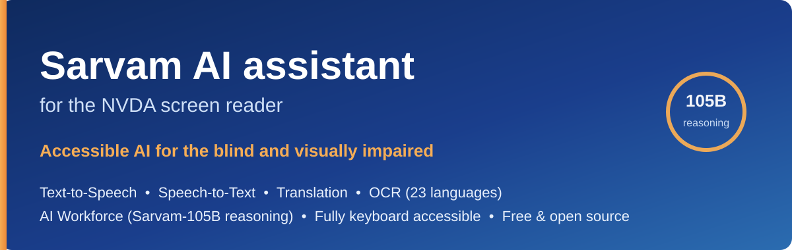

# Sarvam AI assistant for NVDA



> **Available in the official NVDA Add-on Store.** Open NVDA → Tools → Add-on
> Store → Available add-ons and search for *Sarvam AI assistant*.

An accessible NVDA add-on that brings the [Sarvam AI](https://www.sarvam.ai/)
platform to blind and low-vision users through a fully keyboard-driven,
screen-reader-friendly interface that feels native to NVDA.

## Who this is for — and why it matters

This add-on is built **for blind and visually-impaired (VI) users**, and for the
Indian-language accessibility community in particular.

- **Independence.** Powerful AI — natural speech, transcription, translation,
  document reading (OCR) and reasoning — reachable entirely by keyboard and
  screen reader, with no sighted assistance and no inaccessible web dashboards.
- **Indian languages first.** Most assistive AI targets English and Western
  markets. Sarvam is India's most comprehensive language-AI platform, so blind
  users get high-quality speech, OCR and translation across **23 Indian
  languages** — including code-mixed text — right inside NVDA.
- **Read anything.** Turn scanned PDFs, images and photographed documents into
  text with OCR, then have it spoken, translated or summarised — a common
  barrier for VI users made routine.
- **An AI workforce at your fingertips.** The new AI Workforce uses Sarvam's
  105B reasoning model to help with research, writing, coding, planning,
  studying and multi-step tasks — presented in one accessible dialog.
- **Accessible by design, not as an afterthought.** Standard NVDA controls,
  logical focus order, spoken status, a cancellable progress dialog, and
  Escape-to-exit everywhere. Nothing freezes NVDA.
- **Free and open source (GPL v2).** No lock-in; you bring your own Sarvam API
  key.

## Features

- **Text to Speech** – synthesise speech from typed/pasted text or an uploaded
  **text, Word (.docx) or EPUB** file. Choose a **speaking style** (News reader,
  Conversational, Narration, Formal, Expressive) and a **gender**, and the
  **voice list filters itself** to matching voices. Speed, Pitch and Volume
  sliders announce their purpose. After Convert: **Listen, Save as MP3, Save as
  WAV**.
- **Speech to Text** – transcribe an audio file or your microphone. **Large
  audio is handled automatically** via Sarvam's batch transcription service and
  merged into one complete transcript. Optional translate-to-English. Save as
  TXT or DOCX.
- **Translation, Transliteration & Language detection** – one dialog with a
  single **Operation** dropdown. **Upload a document** (TXT/DOCX/EPUB/PDF/image
  — PDFs and images are read with OCR first). Text of any length is chunked and
  rejoined automatically.
- **OCR — Sarvam Document Intelligence** – layout analysis **preserves
  headings, lists, tables, multi-column text and reading order** instead of
  flattening them. Multi-page PDFs keep page order. **Auto detect** language or
  choose from 23. Save as **Markdown** (Sarvam's original structure), **Word**
  (real headings and tables) or plain text.
- **AI Workforce (Sarvam-105B)** – one module for **AI Assistant, AI Summary,
  Document Analysis, General AI Workforce, Content Generation, Question
  Answering and File Analysis**. Upload any supported file (documents, PDFs,
  images, audio) as context, ask a question, choose reasoning effort, and save
  the result as TXT, DOCX or Markdown.
- **Accessibility-first** – save options appear only once a task succeeds,
  Escape closes any window from anywhere, every control is labelled, and no
  long task ever blocks NVDA.

## Requirements

- NVDA 2021.1 or later (tested up to 2026.1).
- Windows 10 / 11.
- A Sarvam AI API key – press **Generate API key** in the add-on's settings, or
  get one from the [Sarvam dashboard](https://dashboard.sarvam.ai/). Note that
  Sarvam endpoints consume account credits.

## Installation

1. Download the latest `sarvamAI-x.y.z.nvda-addon` from the
   [Releases page](https://github.com/rakeshhonisty/Sarvam-AI-assistant/releases)
   (or build it yourself – see below).
2. In NVDA, open the **Add-on Store** (or **Tools → Manage add-ons**), choose
   **Install from external file**, and select the downloaded file.
3. Restart NVDA when prompted.

## First-time setup

1. Open **NVDA menu → Tools → Sarvam AI → Settings…** (or NVDA **Preferences →
   Settings → Sarvam AI**).
2. Paste your **Sarvam API key**.
3. Press **Validate key / Test connection**. You should hear a confirmation
   listing the available models. If you hear *"no credits available"*, your key
   is valid but your account needs credits.
   (No key yet? Press **Generate API key** to open the Sarvam developer portal.)
4. Adjust your defaults, then press **Save**. More options live under
   **Advanced settings**, including **Batch processing speed (1x–10x)**.

## Using the add-on

Everything is reachable from **Tools → Sarvam AI** in the NVDA menu:

| Menu item | What it does |
|-----------|--------------|
| Text to Speech… | Synthesise and play/save speech. |
| Speech to Text… | Transcribe a file or the microphone. |
| Translate… / Transliterate… / Detect language… | Text language tools. |
| OCR… | Sarvam Document Intelligence OCR of a PDF/image, preserving tables and layout. |
| AI Workforce… | Assistant, summary, document analysis, content generation and file analysis via Sarvam-105B. |
| Settings (API key)… | API key, Generate API key, and core defaults. |
| Advanced settings… | All options, including batch processing speed. |
| Logs… | View / export the add-on log. |
| Check for updates… | Check GitHub for a newer release. |
| Help… / About… | Documentation and version info. |

### Keyboard shortcuts

No shortcut is bound by default, so nothing clashes with NVDA's own commands
(an earlier default clashed with NVDA's sound-split command). Assign your own in
**NVDA → Preferences → Input Gestures → Sarvam AI** — for example "Opens the
Sarvam AI menu", or go straight to Text to Speech, Speech to Text, Translate,
OCR or AI Workforce.

Inside any Sarvam AI window, **Escape closes it** — even from inside a text box.

## Building from source

No third-party build tools are required – a `.nvda-addon` is just a ZIP.

```bash
python build.py            # build and copy the package to your Downloads folder
python build.py --no-copy  # build only
python build.py --pot      # regenerate the translation template
```

The packaged add-on appears in the repository root and (by default) in your
`Downloads` folder.

## Accessibility

This add-on is designed accessibility-first: labelled controls, logical focus
order, standard NVDA dialogs, spoken status messages, a cancellable and
announced progress dialog, and no custom inaccessible widgets. All long-running
network calls run on background threads so NVDA never freezes.

## Privacy & security

- Your API key is stored in NVDA's configuration, lightly **obfuscated** (not
  clear text). This is obfuscation, not strong encryption – treat the machine
  as trusted.
- Text, audio, images and documents you process are sent to Sarvam's servers
  for processing (including Sarvam Document OCR). Nothing is sent anywhere else,
  and the add-on itself collects no data.

## License

Released under the **GNU General Public License, version 2**. See
[LICENSE](LICENSE).

## Author and contact

Created by **Rakesh**.

- Email: <rakesh.honistyboy@gmail.com>
- Repository: <https://github.com/rakeshhonisty/Sarvam-AI-assistant>
- Issues / feature requests: <https://github.com/rakeshhonisty/Sarvam-AI-assistant/issues>

## Credits

Built for the NVDA screen reader. Sarvam AI and its API are the property of
Sarvam AI. This is an independent community add-on, not affiliated with or
endorsed by Sarvam AI or NV Access.
